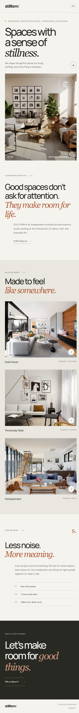

# STILLFORM — Architecture Studio Landing Page

STILLFORM is a responsive, single-page website for a fictional independent architecture and interiors studio. Its editorial layout combines large typographic headlines, warm neutral colors, architectural photography, and concise studio messaging to present the practice and its selected work.

The project is built with plain HTML, CSS, and JavaScript. It has no build step, package manager, or runtime dependencies.



## Page sections

1. **Header and navigation** — Studio, selected work, approach, and contact links. The menu collapses into an accessible toggle on smaller screens.
2. **Hero** — Studio introduction, primary headline, architectural photograph, and a link to the project gallery.
3. **Studio introduction** — A brief description of the practice and a link to the approach section.
4. **Selected work** — Three featured projects with images, locations, project types, and email inquiry links.
5. **Approach** — A short overview of the studio’s process and guiding principles.
6. **Contact call to action** — An email link for prospective project inquiries.
7. **Footer** — Studio wordmark, short tagline, and a copyright year that updates automatically.

## Project files

```text
.
├── index.html      # Page content, metadata, and semantic structure
├── styles.css      # Visual design, responsive layouts, and motion preferences
├── script.js       # Mobile navigation behavior and current copyright year
├── screenshot.png  # Full-page browser screenshot included in this README
└── README.md       # Project overview and usage instructions
```

### How the files work together

- `index.html` contains the page sections and links to the stylesheet and script. Each local navigation link points to an ID on the page.
- `styles.css` defines the colors and font stacks with CSS custom properties, along with the desktop layout and responsive breakpoints.
- `script.js` opens and closes the small-screen navigation, updates its accessible label and expanded state, and fills in the current year.

## Run locally

No installation or compilation is necessary:

1. Download or clone the project folder.
2. Open `index.html` in a modern web browser.

For local development, you can also serve the folder with a static HTTP server. For example, if Python is installed:

```powershell
py -m http.server 8000
```

Then visit [http://localhost:8000](http://localhost:8000). Stop the server with **Ctrl+C** in the terminal.

## Customize the page

### Update studio content and links

Edit the section copy, project names, locations, and image alternative text in `index.html`. Replace the fictional studio email address (`hello@stillform.studio`) with the address used by your project. The selected project cards currently open email drafts with the project name in the subject line.

The footer’s “Instagram” text is a placeholder and currently links to the studio email address. Replace its `mailto:` URL with the studio’s social profile URL if you want it to link to Instagram.

### Replace photographs

The hero and project photographs use remote image URLs from Unsplash. Replace the corresponding `src` values in `index.html` to use different photographs. Keep the `alt` text accurate and descriptive, and provide suitably sized, optimized images for the image containers.

### Adjust the visual theme

At the beginning of `styles.css`, the `:root` custom properties define the main background, text, border, accent, and font stacks. Update these values to change the site-wide theme. The media queries near the end of the stylesheet control tablet and mobile layouts.

## Responsive design and accessibility

- Layouts adapt at tablet and mobile breakpoints, including a stacked project gallery on narrow screens.
- The mobile menu button exposes its state using `aria-expanded`, has a descriptive accessible label, and closes after a navigation link is selected.
- Images have alternative text; the decorative wordmark stamp is hidden from assistive technology.
- The document sets a page description, a responsive viewport, and a theme color.
- Users who prefer reduced motion receive reduced transition and scrolling animations.
- Semantic landmarks and descriptive navigation labels support screen-reader navigation.

## External resources

The page loads the **DM Sans** and **Manrope** typefaces from Google Fonts and its photographs from Unsplash. An internet connection is needed to load those remote assets. Without access to Google Fonts, the page falls back to locally available sans-serif and serif fonts; remote photographs may not appear offline.

## Browser support

The page is intended for current desktop and mobile browsers with support for CSS Grid, custom properties, and standard DOM APIs. No framework or JavaScript library is required.